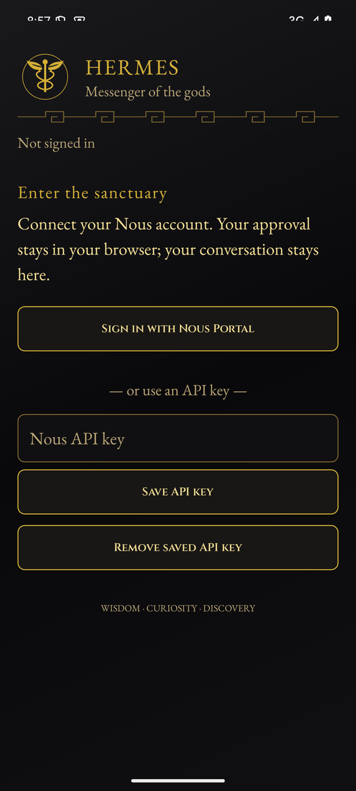
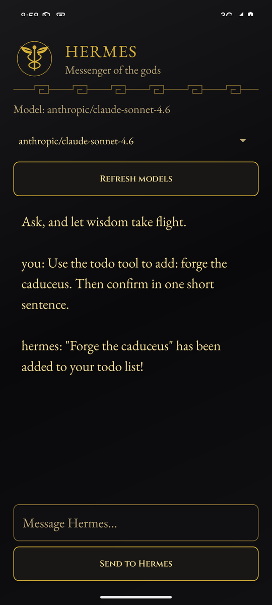

# Hermes for Android

A Kotlin + Gradle Android app that packages this repository's Hermes Python code
with [Chaquopy](https://chaquo.com/chaquopy/) (embedded CPython 3.13) and talks to
[Nous Portal](https://portal.nousresearch.com) for inference. The UI is
gold-on-obsidian with a Greek mythology theme: a caduceus emblem and launcher icon,
Greek key (meander) dividers, Cinzel headings and EB Garamond body text.

| Sign-in ("Enter the sanctuary") | Chat (live Nous reply, todo tool) |
| --- | --- |
|  |  |

Screenshots are from the Android 15 x86_64 emulator.

## Requirements

- Phone: 64-bit (`arm64-v8a`) Android 8.0+ (minSdk 26). The APK also has `x86_64`
  for emulators. 32-bit devices aren't supported, because Python 3.12+ on Android is 64-bit only.
- Build machine: JDK 17, Android SDK (platform 35, build-tools 35), and **Python 3.13 on
  `PATH` as `python3.13`**. Chaquopy needs it to byte-compile the bundled code.

## Build

```bash
cd android
export ANDROID_HOME=/path/to/android-sdk   # or put sdk.dir in local.properties
./gradlew assembleDebug testDebugUnitTest
# -> app/build/outputs/apk/debug/app-debug.apk
```

The build stages the Hermes sources from the repository root (`..`) into
`app/build/hermes-src` and pip-installs them with `--no-deps`. To bundle a
different checkout, use `./gradlew assembleDebug -PhermesSource=/path/to/hermes-agent`.

### Checks

- `python3.13 -S scripts/verify_apk_startup.py app/build/outputs/apk/debug/app-debug.apk`
  runs the APK's packaged Python on the host. It tests imports, HOME setup, auth
  state, and the tool loop against a mock transport.
- `scripts/emulator_smoke.sh` installs the APK on a running emulator (or boots AVD
  `$AVD`, default `hermes_x86_64`). It launches the app and checks the on-device
  Hermes import self-test. If `NOUS_API_KEY` is set, it also sends one live prompt.
- Debug builds take these intent extras: `--ez debug_selftest true` imports the
  bundled Hermes modules and logs the result under the `HermesSelfTest` tag;
  `--es nous_api_key …` stores a key; `--es debug_prompt …` sends one message.
  Release builds ignore all of them.

## CI

`.github/workflows/android-apk.yml` builds and unit-tests the debug APK on every push
or PR that touches `android/`, runs the offline APK smoke test, and uploads the
`hermes-android-debug` artifact. On `main`, tags, or a manual dispatch, a release job
builds `assembleRelease` and signs it with `apksigner`. It runs only when all four
repository secrets are set: `ANDROID_KEYSTORE_BASE64`, `ANDROID_KEYSTORE_PASSWORD`,
`ANDROID_KEY_ALIAS`, `ANDROID_KEY_PASSWORD`. Otherwise it posts a notice and skips.

## Install (sideload)

- With adb: `adb install -r app-debug.apk`
- On the phone: download the `hermes-android-debug` artifact from the Actions run,
  unzip it, open the APK, and allow "Install unknown apps" for your browser or file manager.

## Sign in

1. Tap **Sign in with Nous Portal**. The app requests a device code from
   `portal.nousresearch.com` (client `hermes-cli`, the same flow as `hermes setup --portal`).
2. Tap **Open Nous approval page**, approve the code shown in the app, then come back.
   The app polls until approval, then stores the tokens in app-private storage
   (`files/auth.json`, `files/shared/nous_auth.json`). It refreshes them before they
   expire, and mints an agent key when the token lacks `inference:invoke`.
3. Or paste a Nous API key. It's stored in EncryptedSharedPreferences (Android Keystore).

See `docs/portal-auth-spec.md` for the protocol notes behind the sign-in flow.

## What runs on Android, and what doesn't

The app bundles the Hermes package (`hermes_cli`, `agent`, `tools`, `run_agent`, …),
and these modules import on the device. But Hermes' full `AIAgent` loop needs the
`openai` SDK, which needs `pydantic-core` (Rust). Chaquopy has no wheel for it, so it
isn't bundled. Instead, chat runs through an OpenAI-compatible tool loop over Android's
own HTTPS stack against `inference-api.nousresearch.com/v1`. The only tool it has is
the in-memory **todo** tool.

Not available in the app: terminal and code-execution tools, browser and
computer-use tools, file tools, memory and skills, cron, the messaging gateway, MCP,
voice, image generation, and the TUI/CLI. Network access is limited to
`portal.nousresearch.com` and `inference-api.nousresearch.com` over HTTPS.

## Known limits

- You need an internet connection; all models run on Nous servers.
- Android may stop the app in the background. Keep it in the foreground during long
  replies, and consider excluding it from battery optimization.
- Replies show as plain text, so Markdown such as `**bold**` appears as typed.
- Chat history isn't saved; each message is sent as a new single-turn conversation.
